# Inteligencia de medios y datos para campañas políticas
### Caso de estudio: Bogotá 2027

**Convierto miles de noticias y datos públicos en decisiones de comunicación.**
Recolecto con código lo que dicen los medios, lo contrasto con datos oficiales y lo traduzco en una estrategia clara, con documentos y piezas audiovisuales listas para presentar.

Este repositorio muestra un proyecto completo de punta a punta: **1.093 noticias de 85 medios**, analizadas y cruzadas con **6 fuentes de datos públicos** (oficiales y de encuestas). El análisis terminó en un dossier, un brief de consultoría y un video ensayo.

> 🔒 **Sobre la estrategia:** aquí se publican el método, el código, los datos y el diagnóstico. La estrategia de comunicación (el brief de consultoría y el dossier completo) es trabajo de consultoría y **no se publica**; la comparto bajo solicitud.

> **English summary.** End-to-end media-intelligence case study. I scraped and coded 1,093 news articles from 85 outlets about a Bogotá mayoral hopeful, cross-checked coverage against official open data (elections, crime, poverty, homelessness, public-opinion surveys), mapped media ownership, and turned the findings into a data-driven communication strategy, a 4-page consulting brief and a narrated video essay. Stack: Python (requests, BeautifulSoup, pandas, matplotlib, shapely, python-docx, Pillow, MoviePy), open-data APIs, Google Trends and generative AI tools.

---

## El caso en 30 segundos

| | |
|---|---|
| **El problema** | Un precandidato a la Alcaldía de Bogotá es muy visible en los medios. ¿Esa visibilidad le sirve para ganar la ciudad? |
| **Lo que hice** | Recolecté y clasifiqué todo lo que publicaron sobre él en un año, revisé quién es dueño de cada medio y lo crucé con los datos reales de las 20 localidades. |
| **Lo que encontré** | **0 de 1.093 notas** lo ubican en una localidad de Bogotá. Una frase sobre "incendiar el país" salió en **52 notas**; su aspiración a la Alcaldía, en **2**. Tiene visibilidad, pero no un relato de ciudad. |
| **Lo que entregué** | Matriz de 10 precandidatos, fichas, dossier de 20 páginas, brief de consultoría de 4 páginas con estrategia e indicadores, presentación y video ensayo narrado. |

---

## Lo que demostré, hallazgo por hallazgo

Cada gráfica es un resultado del análisis y, al mismo tiempo, la prueba de una habilidad.

### 1. La cobertura se dispara con las peleas, no con Bogotá
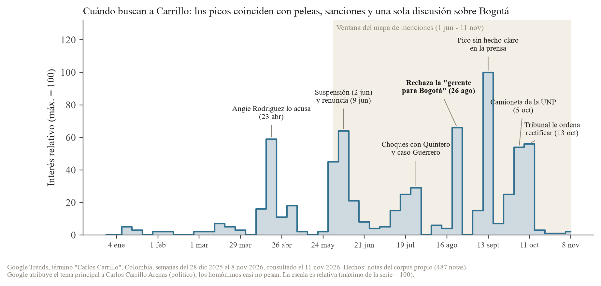

<sub>🐍 Generada con Python: [`14_dossier_graficas.py`](codigo/1_datos_y_scraping/14_dossier_graficas.py#L51) (matplotlib)</sub>

**Qué muestra:** el interés en Carrillo semana a semana. Los picos coinciden con peleas, sanciones y choques políticos, y solo uno con una discusión sobre Bogotá.

**Habilidad:** series de tiempo y lectura de picos (Google Trends cruzado con el corpus de noticias).

### 2. La agenda que lo rodea es nacional
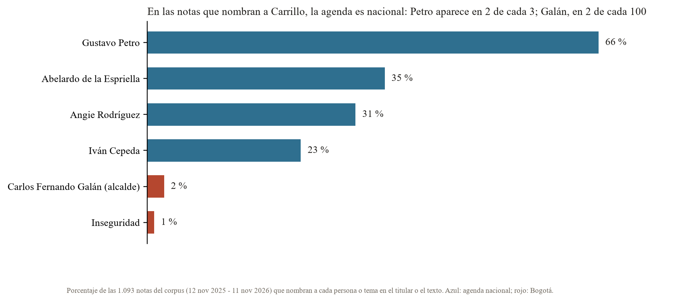

<sub>🐍 Generada con Python: [`17_dossier_graficas4.py`](codigo/1_datos_y_scraping/17_dossier_graficas4.py#L58) (matplotlib)</sub>

**Qué muestra:** en las notas que lo nombran, Gustavo Petro aparece en 2 de cada 3 y el alcalde de Bogotá en 2 de cada 100.

**Habilidad:** análisis de contenido automatizado sobre 1.093 notas.

### 3. Una entrevista, dos noticias: 52 contra 2
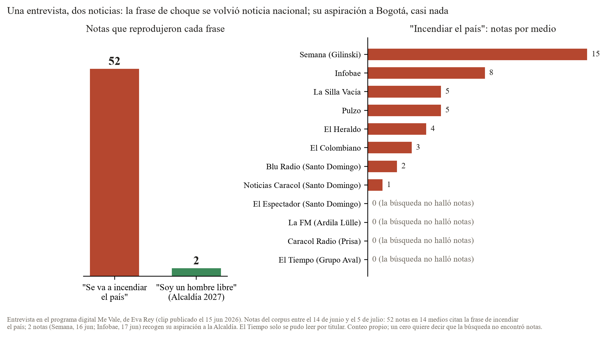

<sub>🐍 Generada con Python: [`16_dossier_graficas3.py`](codigo/1_datos_y_scraping/16_dossier_graficas3.py#L44) (matplotlib)</sub>

**Qué muestra:** de una misma entrevista, la frase de choque ("el país se va a incendiar") salió en 52 notas de 14 medios; su aspiración a la Alcaldía, en 2.

**Habilidad:** rastrear cómo se reproduce una frase entre medios, es decir, la noticiabilidad del conflicto medida con datos.

### 4. Cada medio lo encuadra distinto, y ninguno habla de Bogotá
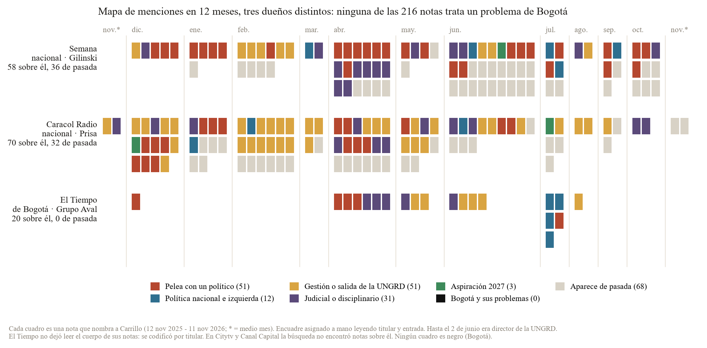

<sub>🐍 Generada con Python: [`15_dossier_graficas2.py`](codigo/1_datos_y_scraping/15_dossier_graficas2.py#L99) (matplotlib)</sub>

**Qué muestra:** 12 meses de cobertura en tres medios con dueños distintos (Semana, Caracol Radio y El Tiempo). Cada cuadro es una nota y su color, el encuadre. Ninguna de las 216 notas trata un problema de Bogotá.

**Habilidad:** codificación de encuadres validada con lectura humana.

### 5. Quién es dueño de los medios que lo cuentan
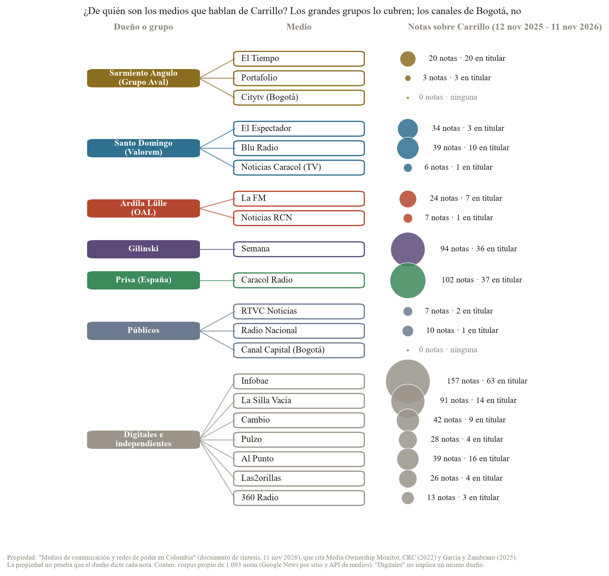

<sub>🐍 Generada con Python: [`15_dossier_graficas2.py`](codigo/1_datos_y_scraping/15_dossier_graficas2.py#L67) (matplotlib)</sub>

**Qué muestra:** los grandes grupos (Prisa, Gilinski, Santo Domingo, Ardila Lülle, Grupo Aval) concentran la cobertura; los canales de la ciudad casi no lo nombran.

**Habilidad:** mapeo de la propiedad de los medios cruzado con la cobertura (economía política de los medios).

### 6. Lo que pide la gente frente a lo que dicen las noticias
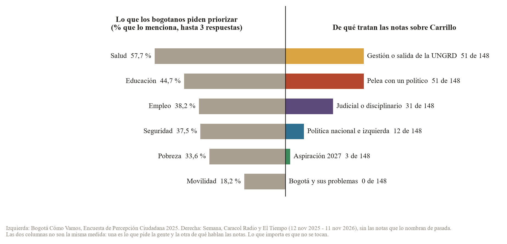

<sub>🐍 Generada con Python: [`15_dossier_graficas2.py`](codigo/1_datos_y_scraping/15_dossier_graficas2.py#L171) (matplotlib)</sub>

**Qué muestra:** los bogotanos piden salud (57,7 %), educación, empleo y seguridad; las notas sobre él hablan de peleas y de la UNGRD, y 0 de 148 tratan un problema de la ciudad.

**Habilidad:** cruzar una encuesta de opinión (Bogotá Cómo Vamos) con el corpus de medios.

### 7. Qué tanto lo busca la gente en Bogotá
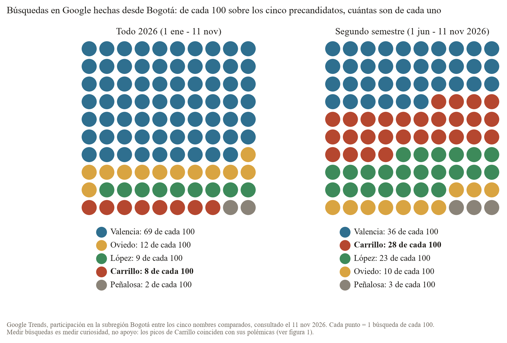

<sub>🐍 Generada con Python: [`18_dossier_mapas3.py`](codigo/1_datos_y_scraping/18_dossier_mapas3.py#L108) (matplotlib)</sub>

**Qué muestra:** de cada 100 búsquedas hechas desde Bogotá sobre los cinco precandidatos, cuántas son de cada uno, en todo 2026 y en el segundo semestre.

**Habilidad:** medir la atención pública con datos de búsqueda.

### 8. Donde hay más pobreza, más votó la izquierda
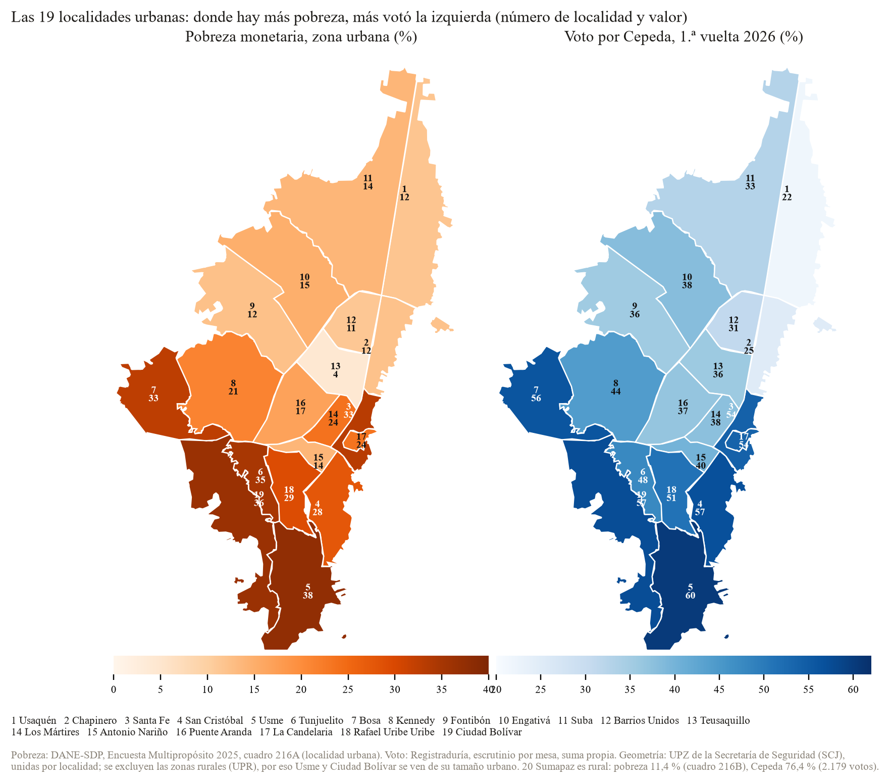

<sub>🐍 Generada con Python: [`15_dossier_graficas2.py`](codigo/1_datos_y_scraping/15_dossier_graficas2.py#L132) (matplotlib)</sub>

**Qué muestra:** pobreza monetaria (DANE-SDP 2025) y voto de izquierda en la primera vuelta de 2026, localidad por localidad: la geografía coincide.

**Habilidad:** cartografía (GIS) y cruce de datos sociales con resultados electorales.

### 9. El territorio donde está su voto y donde no aparece
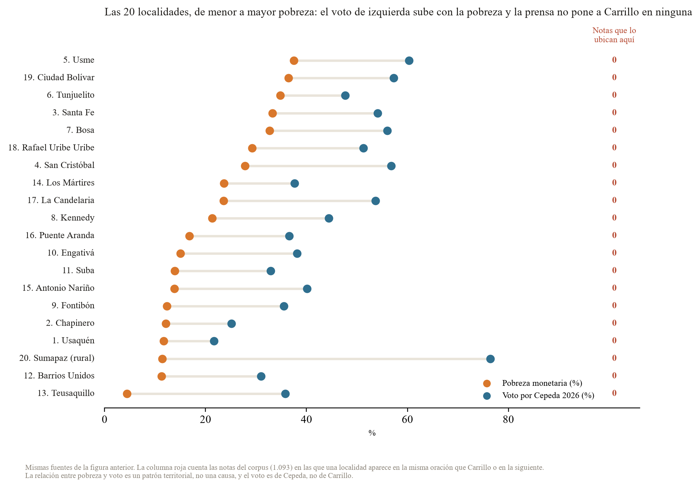

<sub>🐍 Generada con Python: [`15_dossier_graficas2.py`](codigo/1_datos_y_scraping/15_dossier_graficas2.py#L151) (matplotlib)</sub>

**Qué muestra:** las 20 localidades ordenadas por pobreza. El voto de izquierda sube con la pobreza, pero la prensa no ubica al precandidato en ninguna.

**Habilidad:** visualización comparativa de varias variables por territorio.

### 10. El sur no es de nadie
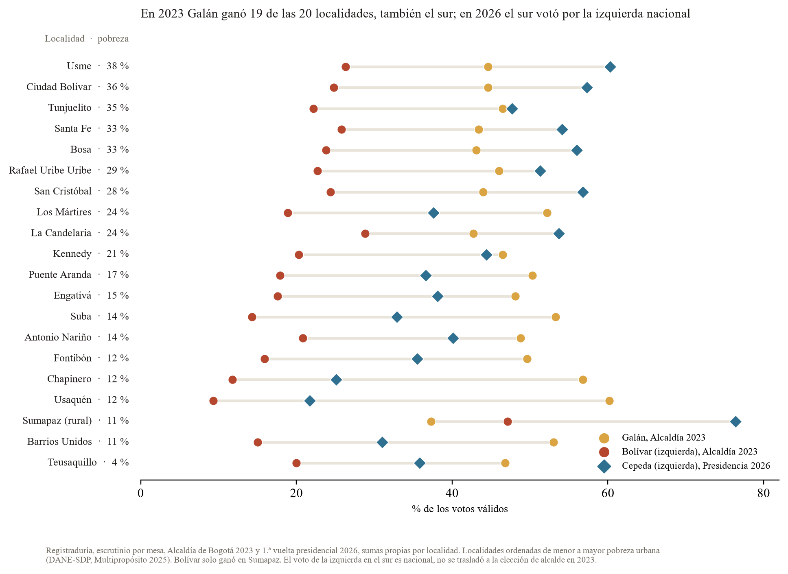

<sub>🐍 Generada con Python: [`17_dossier_graficas4.py`](codigo/1_datos_y_scraping/17_dossier_graficas4.py#L43) (matplotlib)</sub>

**Qué muestra:** en 2023 Galán ganó 19 de las 20 localidades, también el sur; en 2026 el sur votó por la izquierda nacional. El voto se mueve.

**Habilidad:** análisis electoral comparado entre elecciones (resultados por mesa de la Registraduría agregados por localidad).

### 11. Datos sociales del video: no es un solo alcalde, ni una sola zona
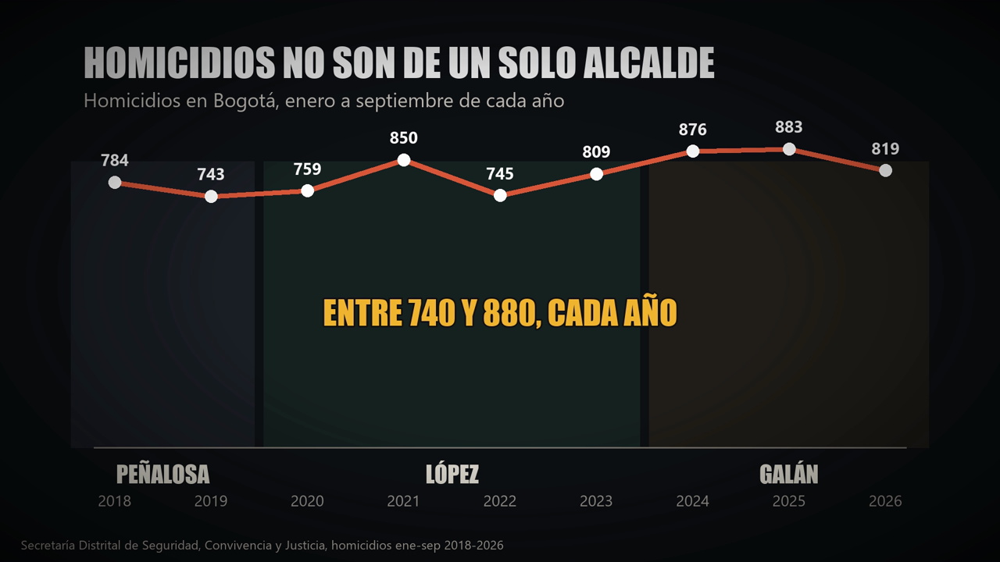
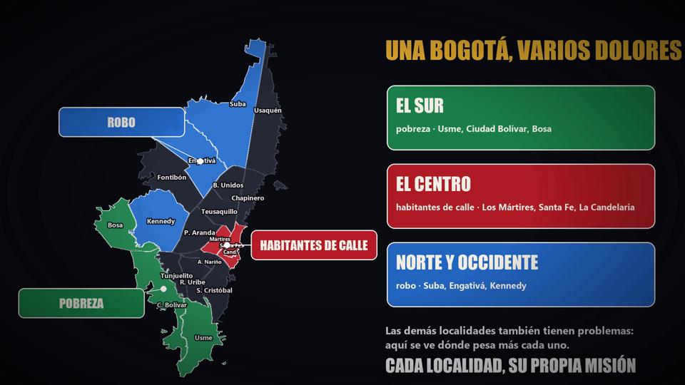

<sub>🐍 Animaciones generadas con Python: [`video_anim.py`](codigo/2_video/video_anim.py) (Pillow + MoviePy)</sub>

**Qué muestra:** los homicidios se mueven entre 740 y 880 al año (enero a septiembre) con tres alcaldes distintos, y cada zona tiene su propio problema: pobreza en el sur, habitantes de calle en el centro y robo en el norte y el occidente.

**Habilidad:** comunicar datos de forma visual y animada para el público general (video ensayo).

### 12. El método, contado en el video
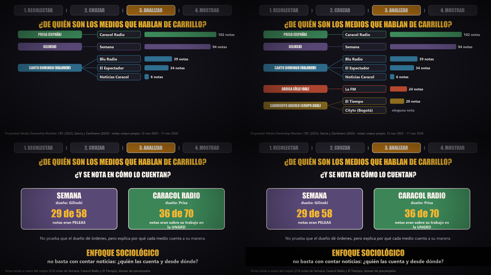
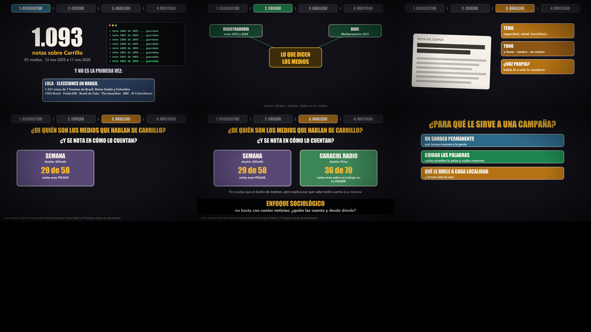

<sub>🐍 Animaciones generadas con Python: [`video_anim.py`](codigo/2_video/video_anim.py) (Pillow + MoviePy)</sub>

**Habilidad:** explicar un proceso técnico con lenguaje sencillo y animaciones programadas en Python.

---

## Qué sé hacer, y dónde está la prueba

Agrupé las habilidades en las áreas profesionales a las que pertenecen. Cada una apunta al archivo que la demuestra.

### 1. Recolección y procesamiento de datos · *Data Engineering / OSINT*
- **Web scraping y APIs de noticias:** búsqueda automática por medio y por fecha, descarga y extracción de texto de 85 medios. → `codigo/1_datos_y_scraping/08` y `09`
- **Datos abiertos oficiales:** descarga automática de la Registraduría, el DANE, la Secretaría de Seguridad (API ArcGIS) y datos.gov.co. → scripts `01`, `03` y `07`
- **Limpieza y deduplicación:** quitar notas repetidas, irrelevantes o sin fecha. → script `10`

### 2. Análisis de datos y de contenido · *Data Analytics / Computational Social Science*
- **Codificación de un corpus:** clasificar cada nota por tema, encuadre (pelea, gestión, judicial…), si el político habla con voz propia y si menciona una localidad. → scripts `11` y `12` · `datos/corpus_carrillo_metadatos.csv`
- **Validación humana:** lectura a mano de 216 notas para comprobar la clasificación automática.
- **Cruce con indicadores sociales y electorales** por localidad: pobreza, tiempo de viaje, delitos, votos 2023 y 2026. → scripts `02`, `04` y `05`

### 3. Visualización y mapas · *Data Visualization / GIS*
- Gráficas explicativas, mapas por localidad (coropletas) y la red de propiedad de los medios. → scripts `06` y `14` a `18` · `imagenes/`

### 4. Inteligencia de medios · *Media Intelligence / Social Listening*
- **Monitoreo de cobertura:** quién habla de un actor, cuánto, cómo y en qué momento.
- **Propiedad de los medios:** qué grupos económicos están detrás de cada medio y cómo cambia el encuadre entre ellos.
- **Picos y búsquedas:** Google Trends como termómetro de lo que le interesa a la gente. → script `13`

### 5. Comunicación política y consultoría · *Public Affairs / Political Consulting*
- Diagnóstico de reputación mediática y brief de consultoría con estrategia, mensajes, indicadores, riesgos y plan de trabajo (bajo solicitud).
- Comparación de 10 precandidatos. → `entregas/Matriz_10_precandidatos.xlsx` · `entregas/Fichas_5_precandidatos.pdf`

### 6. Investigación social con teoría · *Social Research*
- Lectura sociológica de los datos: noticiabilidad (Wolf), opinión pública (Lippmann), poder y comunicación (Castells), el medio como mensaje (McLuhan) y capital simbólico (Bourdieu). Los datos no quedan sueltos: se explica por qué pasan las cosas.

### 7. Producción de contenido con código e IA · *Content Production / Generative AI*
- Video ensayo narrado con animaciones de datos programadas en Python, sincronización automática de la voz con las imágenes, base visual de Google Flow y edición propia. → `codigo/2_video/`
- Documentos profesionales generados con código (Word y PDF), con control exacto de extensión.

### 8. Rigor y ética de datos · *Data Ethics*
- Cada cifra tiene su fuente. Las que no cuadraban entre fuentes se descartaron y se explica por qué. → `entregas/Fuentes_del_video.md`
- Límites explícitos: qué prueban los datos y qué no.
- No se publica el texto completo de las noticias (derechos de los medios) ni datos privados de nadie.

---

## Para qué roles sirve este trabajo

| Rol | Qué parte de este proyecto lo demuestra |
|---|---|
| Analista de inteligencia y monitoreo de medios | Corpus, codificación, propiedad de medios, picos de cobertura |
| Analista de comunicación política o asuntos públicos | Diagnóstico, matriz de precandidatos, fichas |
| Analista de datos sociales u opinión pública | Cruce con DANE, Registraduría, Secretaría de Seguridad y encuestas |
| Analista de *social listening* o reputación de marca | El mismo método aplica a una marca o empresa en lugar de un político |
| Periodista de datos o investigador | Verificación de cifras, mapas, visualizaciones y narrativa con fuentes |
| Productor de contenido con IA | Video ensayo con animaciones programadas y herramientas generativas |

**El método no es solo para política:** sirve para medir la reputación de una empresa, comparar cómo cubren los medios a la competencia, detectar crisis a tiempo o saber qué le importa a la gente de un territorio.

---

## Cómo trabajo: el método

```
1. RECOLECTAR  →  2. CRUZAR  →  3. ANALIZAR  →  4. MOSTRAR
 scraping y        datos           clasificación    mapas, gráficas,
 APIs de           oficiales       automática +     dossier, brief
 noticias          por territorio  revisión humana  y video
```

1. **Recolectar.** Búsquedas por medio en Google News y una API de medios, del 12-nov-2025 al 11-nov-2026: 1.093 notas de 85 medios.
2. **Cruzar.** Registraduría (2023 y 2026), Encuesta Multipropósito 2025 (DANE-SDP), delitos por localidad 2018-2026 (Secretaría de Seguridad), Censo de Habitantes de Calle 2024 (SDIS), Bogotá Cómo Vamos y Google Trends.
3. **Analizar.** Clasificación por reglas, verificada a mano en 216 notas, y mapa de propiedad de los medios.
4. **Mostrar.** Documentos y piezas que alguien sin formación técnica entiende y puede usar para decidir. La estrategia que sale de este análisis va en un brief aparte, que no se publica.

---

## Entregables

| Archivo | Qué es | Para qué sirve |
|---|---|---|
| [Matriz de 10 precandidatos](entregas/Matriz_10_precandidatos.xlsx) | Comparación de cobertura y perfil | Mapa del escenario |
| [Fichas de 5 precandidatos](entregas/Fichas_5_precandidatos.pdf) | Perfil de prensa de cada uno | Conocer a los competidores |
| [Fuentes primarias](entregas/Fuentes_primarias.xlsx) · [Anexo del corpus](entregas/Anexo_corpus.xlsx) | Datos y enlaces | Que cualquiera pueda verificar |
| 🔒 Video ensayo (16 min) | Narración con animaciones de datos | Bajo solicitud |
| 🔒 Brief de consultoría (4 págs.), dossier completo (20 págs.) y presentación | Estrategia, mensajes, indicadores y plan de trabajo | Bajo solicitud |

---

## Herramientas

**Python** (requests, BeautifulSoup, pandas, matplotlib, shapely, openpyxl, python-docx, Pillow, MoviePy, numpy) · **APIs y datos abiertos** (ArcGIS de la Secretaría de Seguridad, datos.gov.co, Registraduría, DANE) · **Google Trends** · **IA generativa** (Google Flow para video y asistentes de IA para programar) · **Word, Excel y PDF**.

## Estructura del repositorio

```
codigo/
  1_datos_y_scraping/   01-20: descarga, limpieza, clasificación, gráficas, mapas y Excel
  2_video/              animaciones, montaje y sincronización de la voz
datos/                  corpus (solo metadatos), indicadores por localidad, votos, delitos y mapas
entregas/               PDF y Excel finales
imagenes/               gráficas y cuadros del video
```

## Cómo correrlo

```bash
pip install requests beautifulsoup4 pandas matplotlib shapely openpyxl python-docx pillow moviepy numpy
```

Los scripts de `codigo/1_datos_y_scraping/` están numerados en el orden en que se corren. Las claves de las APIs se leen de variables de entorno: este repositorio no incluye ninguna.

## Límites

- El corpus sale de búsquedas: es amplio, pero no es todo lo publicado.
- La propiedad de un medio no prueba que el dueño dicte las notas.
- No hay encuesta propia de intención de voto: el proyecto mide cómo suena un precandidato, no quién va a ganar.
- La música, los clips de terceros y el gameplay usados en el video no se incluyen aquí por derechos de autor.

---

## Sobre mí

**Diego Umbarila.** Uno el análisis social con herramientas de datos para entender cómo se construye la opinión pública y convertirlo en decisiones de comunicación. Proyecto desarrollado en el curso Sociología de la Información y los Medios (2026).

📫 Contacto: a través de mi perfil de GitHub, [@Tendo08](https://github.com/Tendo08).
